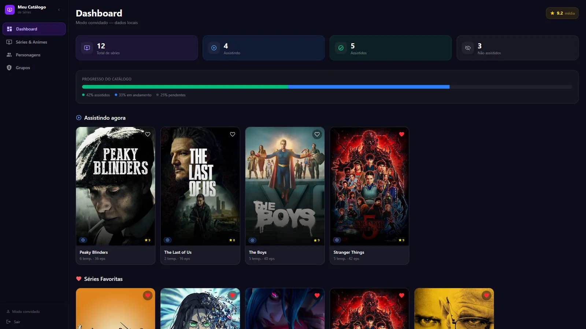
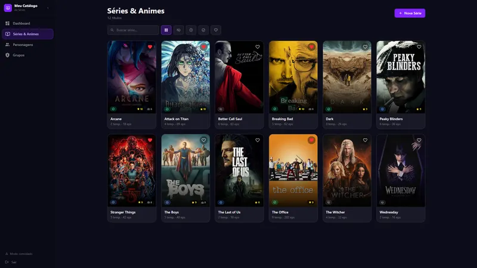
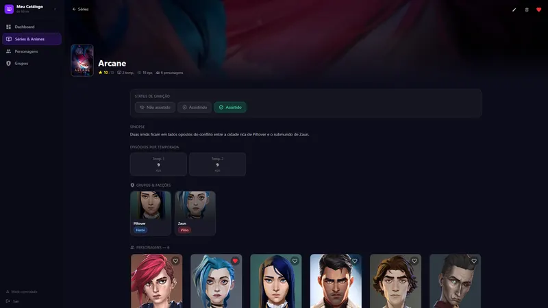
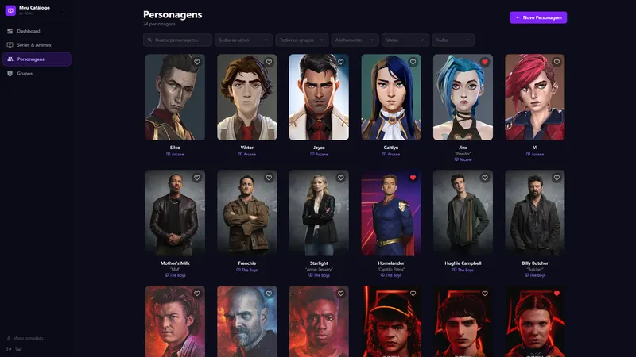
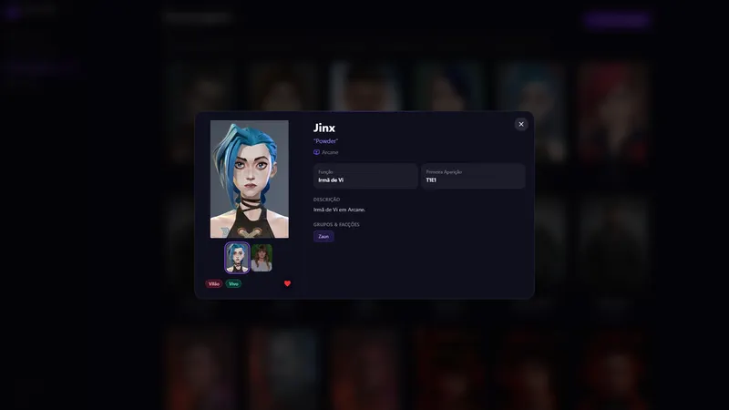
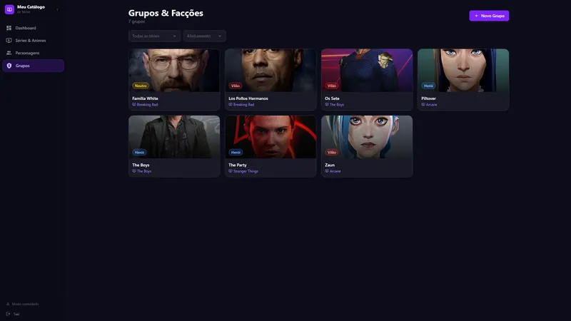

# Catálogo de Séries, Personagens e Grupos

Organize séries e animes, personagens e grupos — com modo convidado que funciona sem servidor.

<p align="center">
  
</p>

---

## Sumário

- [Visão geral](#visão-geral)
- [Telas](#telas)
- [Stack e versões](#stack-e-versões)
- [Estrutura do projeto](#estrutura-do-projeto)
- [Primeiros passos](#primeiros-passos)
- [Configuração do Supabase](#configuração-do-supabase)
- [Variáveis de ambiente](#variáveis-de-ambiente)
- [Scripts](#scripts)
- [Deploy](#deploy)
- [Autor](#autor)

---

## Visão geral

Catálogo pessoal de séries e animes com status de exibição (não assistido, assistindo, assistido), avaliação, episódios por temporada e favoritos. Cada série tem personagens com várias imagens, apelido, função, alinhamento (herói, vilão ou neutro) e status, além de grupos que ligam personagens entre si. Funciona com login no Supabase ou em modo convidado, salvando tudo no próprio navegador.

Principais funcionalidades:

- Dashboard com progresso do catálogo e média de avaliação
- Personagens com galeria, alinhamento e status
- Grupos ligando personagens (N:N)
- Filtros combinados por série, grupo, alinhamento e status
- Modo convidado com os dados salvos no navegador

Concluído em 08/2026.

---

## Telas

Todas as telas usam dados fictícios.

<table>
  <tr>
    <td width="50%"><br><sub>Grade de séries e animes</sub></td>
    <td width="50%"><br><sub>Detalhe da série com temporadas, grupos e personagens</sub></td>
  </tr>
  <tr>
    <td width="50%"><br><sub>Lista de personagens com filtros</sub></td>
    <td width="50%"><br><sub>Detalhe do personagem com galeria de imagens</sub></td>
  </tr>
  <tr>
    <td width="50%"><br><sub>Grupos de personagens</sub></td>
  </tr>
</table>

---

## Stack e versões

| Categoria | Tecnologia | Versão |
| --- | --- | --- |
| Linguagem | TypeScript | 6.0 |
| UI | React | 19.2 |
| Build | Vite | 8.0 |
| Rotas | React Router | 7.17 |
| Estilo | Tailwind CSS | 4.3 |
| Back-end | Supabase | 2.108 |
| Ícones | Iconify | 6.0 |
| Qualidade | ESLint + Prettier | 10.3 / 3.8 |

As versões exatas estão no `package.json`.

---

## Estrutura do projeto

```
src/
  assets/
    hero.png
    react.svg
    vite.svg
  components/
    cards/
    ui/
  contexts/
    AuthContext.tsx
    DataContext.tsx
  hooks/
    useCollection.ts
  lib/
    guestDb.ts
    storage.ts
    supabase.ts
  modules/
    characters/
    groups/
    series/
  pages/
    CharactersPage.tsx
    DashboardPage.tsx
    GroupDetailPage.tsx
    GroupsPage.tsx
    LoginPage.tsx
    SerieDetailPage.tsx
    … (+1)
  types/
    database.ts
    index.ts
  App.css
  App.tsx
  index.css
  main.tsx
```

---

## Primeiros passos

### Pré-requisitos

- Node.js 20.19 ou mais recente
- npm

### Instalação

```bash
git clone https://github.com/marcospsdev/my-series-catalog.git
cd my-series-catalog
npm install
cp .env.example .env.local   # preencha os valores (veja abaixo)
npm run dev               # http://localhost:5173
```

Sem configurar o Supabase, use **Continuar como convidado** na tela de login: os dados ficam salvos no próprio navegador.

---

## Configuração do Supabase

1. Crie um projeto em [supabase.com](https://supabase.com) (o plano gratuito é suficiente).
2. No **SQL Editor**, cole e execute o conteúdo de `supabase/schema.sql`. Ele cria as tabelas, as regras de segurança (RLS) e o que mais o app usa.
3. Em **Authentication → Users → Add user**, crie o usuário que vai entrar no sistema (o app não tem tela de cadastro).
4. Em **Settings → API**, copie a **Project URL** e a chave **anon public** para as variáveis de ambiente. Nunca use a chave `service_role` no front-end.

---

## Variáveis de ambiente

Baseie-se no `.env.example`. Nunca commite o `.env.local` nem arquivos com valores reais.

| Variável | Obrigatória | Descrição |
| --- | --- | --- |
| `VITE_SUPABASE_URL` | Sim | URL do projeto no Supabase (**Settings → API → Project URL**) |
| `VITE_SUPABASE_ANON_KEY` | Sim | Chave pública `anon` do Supabase |

---

## Scripts

| Comando | Descrição |
| --- | --- |
| `npm run dev` | Servidor de desenvolvimento (Vite) |
| `npm run build` | Typecheck e build de produção em `dist/` |
| `npm run lint` | Analisa o código com o ESLint |
| `npm run preview` | Serve o build de produção localmente |

---

## Deploy

1. Importe o repositório na [Vercel](https://vercel.com) (o Vite é detectado automaticamente).
2. Build: `npm run build` · saída: `dist`.
3. Cadastre as variáveis de ambiente em **Settings → Environment Variables** (se houver) e faça o deploy.

O `vercel.json` redireciona todas as rotas para o `index.html`, então as rotas do React funcionam ao recarregar a página.

---

## Autor

**Marcos Paulo** · Desenvolvedor Full-Stack

- LinkedIn: [in/marcospsdev](https://www.linkedin.com/in/marcospsdev)
- GitHub: [@marcospsdev](https://github.com/marcospsdev)
